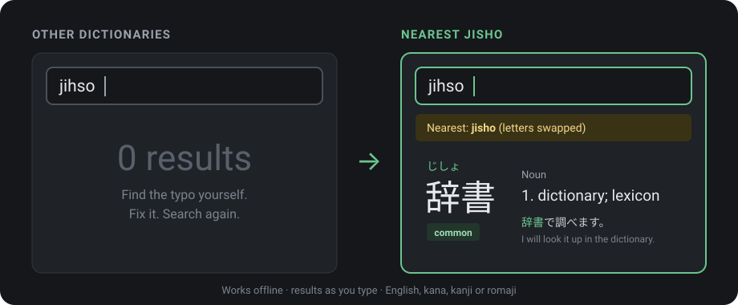

<h1 align="center">Nearest Jisho</h1>

<p align="center"><b>A Japanese dictionary that still finds the word when you mistype it.</b></p>

<p align="center">
  
</p>

<p align="center">
  <a href="https://nostramadeus.github.io/nearest-jisho/"><b>Open in the browser</b></a>
  &nbsp;·&nbsp;
  <a href="https://github.com/Nostramadeus/nearest-jisho/releases/latest"><b>Download for Android, Windows, Linux</b></a>
</p>

## Why I made this

I look up Japanese words all day. With the dictionaries I used, one slip of the fingers was enough to get nothing:
I typed `jihso` when I meant `jisho`, and the answer was zero results, or a list of unrelated words.
Then I had to spot the typo, fix it and search again. Dozens of times a day.

A dictionary knows every real word. It can work out which one I meant. So this one does.

| You type | You get | What it understood |
|---|---|---|
| `jihso` | 辞書 (jisho), dictionary | two letters swapped |
| `gakko` | 学校 (gakkou), school | long vowel left out |
| `konichiwa` | こんにちは (konnichiwa), hello | double letter left out |
| `tensia` | 天才 (tensai), genius | two letters swapped |
| `dictonary` | 辞書, 辞典 | typo in the English word |
| `たべた` | 食べる (taberu), to eat | past form of a verb |

It never hides what you asked for: exact matches always come first, and near matches appear under a
"Did you mean" line that says what was different.

## What is inside

- **Results while you type.** No search button. Type English, kana, kanji or romaji.
- **Works offline.** Everything runs on your device. Nothing you type is sent anywhere.
- **219,000 words, 743,000 names, 10,000 kanji**, plus slang, internet words and sound-effect words with clear labels.
- **110,000 example sentences.** Open a word to see up to 25 real sentences, with the word highlighted in the form it takes.
- **Favorites.** Star a word, copy your list into Anki or a spreadsheet.

All data comes from free, open sources (JMdict, JMnedict, KANJIDIC2, Wiktionary, Tatoeba, jiten.moe). See [DATA-LICENSE.md](DATA-LICENSE.md).

## Download

- Web (any device): https://nostramadeus.github.io/nearest-jisho/
- App files: [latest release](https://github.com/Nostramadeus/nearest-jisho/releases/latest)

| Platform | How to install |
|---|---|
| Android | Download the `.apk` and open it. Allow "install unknown apps" once when the phone asks. |
| Windows | Download and run the `-windows-setup.exe`. On the blue warning, click "More info", then "Run anyway". It uses Microsoft Edge WebView2 (already part of Windows 10 and 11; the setup downloads it if missing). |
| Linux | Download the `.AppImage`, run `chmod +x` on it, then run it. |
| iPhone and Mac | Open the web address. iPhone: Share, then "Add to Home Screen". Mac: install it from the browser (Chrome/Edge install button, Safari "Add to Dock"). |

The warnings are expected: the files are not signed with a paid certificate.
The data is rebuilt every month; each build is a new release.

Updates: the installed apps download newer dictionary data and newer app files from the website by themselves
and use them from the next start. Limit: changes to the native wrapper itself (Capacitor / Tauri versions,
permissions, icons) still need a reinstall. Everything in `app/` updates by itself.

## Build the data

Node 24, no npm packages. The build downloads the sources (streamed, temporary files in `build/.cache/`)
and writes the packs into `app/data/`.

```
node build/build-data.mjs
node build/build-data.mjs --only words,kanji    # rebuild some packs only
```

## Run

Serve the folder `app/` with any static web server and open it in a browser, for example:

```
npx http-server app -a 127.0.0.1      # or any other static server
```

The page needs to be served over `http://127.0.0.1` / `localhost` or `https://` (web workers and the offline
cache do not run from `file://`).

## Command line and tests

```
node tools/query.mjs "jihso"          # ranked results from app/data
node tools/query.mjs --accept         # the acceptance queries from SPEC.md section 7
node tools/query.mjs --bench          # search timings and memory
node --test test/                     # unit and engine tests on a small hand-made fixture
```

## Layout

| Path | What |
|---|---|
| `app/` | the web app: `index.html`, `main.js` (page), `worker.js` (loads data, runs searches), `sw.js` (offline cache) |
| `app/search/` | search engine, runs in the browser worker and in node: romaji, fold keys, typo costs, deinflection, packs |
| `build/` | data build scripts |
| `tools/` | `query.mjs` command line, `make-icons.mjs` |
| `test/` | `node --test test/` |
| `packaging/` | Android (Capacitor) and desktop (Tauri) wrappers; built only on GitHub Actions by `.github/workflows/build.yml` |
| `SPEC.md` | the plan of record |

## Licences

- Code: MIT, see `LICENSE`.
- Dictionary data: JMdict, JMnedict and KANJIDIC2 (© EDRDG, CC BY-SA 4.0), Wiktionary (CC BY-SA 4.0),
  jiten.moe (CC BY-SA 4.0), Tatoeba (CC BY 2.0 FR), JLPT lists (CC BY-SA 4.0). Details and required credits are in
  `DATA-LICENSE.md` and on the app's "About and licences" page.

This site uses the JMdict/EDICT and KANJIDIC dictionary files. These files are the property of the Electronic
Dictionary Research and Development Group, and are used in conformance with the Group's licence.
